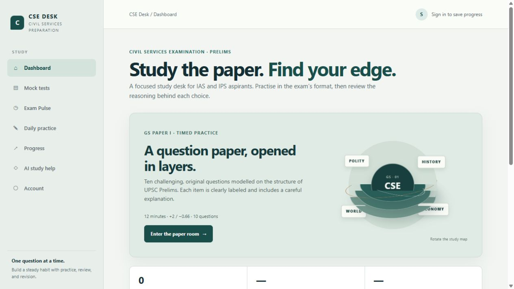

# CSE Desk

CSE Desk is a study tool for UPSC Civil Services aspirants. It brings timed Prelims practice, daily questions, and attempt review into one place.

[Open the live app](https://cse-desk-ias-prep.web.app)



## In the app

- **Mock tests**: timed GS practice with the Prelims marking scheme and answer explanations.
- **Daily practice**: a short set for days when there is no time for a full paper.
- **Exam Pulse**: a rotating practice set and links to official UPSC papers.
- **Progress**: review attempts saved to a signed-in account.
- **AI study help**: prepare a question for ChatGPT or Gemini. The provider opens separately; CSE Desk does not store provider API keys.

Practice questions are original and follow the broad format of Civil Services Prelims. They are not official UPSC questions and do not predict an upcoming paper. Use the [UPSC question paper archive](https://www.upsc.gov.in/examinations/previous-question-papers/archives) for past papers.

## Run locally

You need Node.js. From this directory, run:

```sh
node scripts/preview.mjs
```

Then open <http://127.0.0.1:4173/>.

## Firebase and saved attempts

The live site uses Firebase Hosting in project `cse-desk-ias-prep`. Sign-in uses Firebase Email Link. A signed-in candidate's attempts are stored under that account's UID in the `cse-desk-user-data` Firestore database. The rules in [`firestore.rules`](firestore.rules) restrict access to the account that owns each record.

Scores are calculated in the browser for study use. They are not proctored, tamper-proof, or official UPSC results. Automatic result emails are not enabled in the current deployment; they need App Check and a configured mail provider.

This is an independent study project and is not affiliated with UPSC.